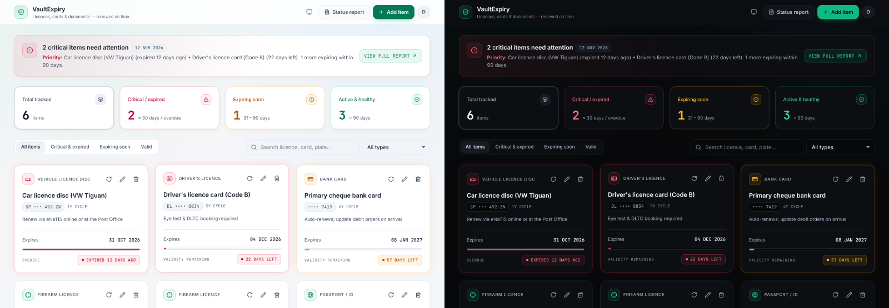

# VaultExpiry

A clean, simple app for tracking when things expire: driver's licence, firearm licence and competency certificate, car licence disc, bank cards, passport/ID, insurance, subscriptions. It shows what needs attention now and what's coming up, and reminds you before anything lapses.



## Features

- **Dashboard:** a summary banner, KPI tiles (critical / soon / healthy), filters, search, and one card per item with a countdown. Light and dark themes that follow the OS, with a manual toggle.
- **Accounts:** sign up, sign in, password reset by email, change password, delete account, JSON export/import, CSV export.
- **Renewals:** "Mark as renewed" suggests the next expiry date from the item's validity cycle and keeps a history. Each item has its own renewal lead time (e.g. firearm licences: apply at least 90 days before).
- **Reminders:** an email digest as items enter their lead-time, "expiring soon", critical and final-week windows, plus a **calendar subscription** with native alarms (Google, Apple, Outlook).
- **Scan a photo (AI):** photograph a licence, disc or card and the form fills itself in using a Groq vision model. You confirm every field. Asks for consent first.
- **Digital copies:** keep photos of each document, **encrypted at rest** and visible only to you (not even to admins).
- **Delete with Undo:** deleted items, with their photos and history, can be restored for 60 minutes.
- **Platform admin console:** manage accounts (resets, unlock, disable, delete) with a full audit log, and no access to anyone's items or photos.
- **PWA:** installable, works offline as a read-only copy, and prompts when an update is ready.

## Quick start

Prerequisites: **Node.js 22+** and **PostgreSQL 13+**.

```bash
npm install
```

```bash
cp .env.example .env    # set DATABASE_URL and SESSION_SECRET (see docs/CONFIGURATION.md)
```

```bash
createdb vaultexpiry
```

```bash
npm run dev             # http://localhost:3000 — migrations run automatically
```

```bash
npm run admin:seed -- --email you@example.com    # optional: create a platform admin
```

```bash
npm run seed:demo       # optional: demo@vaultexpiry.local / demo-password-123
```

Without SMTP configured, development logs password-reset links and reminder emails to the console. Photo storage and AI scanning switch on when `FILE_ENCRYPTION_KEY` and `GROQ_API_KEY` are set.

## Commands

| Command | Purpose |
|---|---|
| `npm start` | Production start (migrations + optional admin bootstrap, then serve) |
| `npm run dev` | Development server with `--watch`, reads `.env` |
| `npm run migrate` | Apply pending database migrations only |
| `npm run admin:seed -- --email <addr> [--name "Name"] [--reset-password] [--demote]` | Create, promote, re-password or demote a platform admin |
| `npm run seed:demo` | Create or refresh the demo account (refuses in production) |
| `npm run lint` / `npm run lint:fix` | ESLint |
| `npm test` | Unit + API integration tests (needs the test database from `.env.test`) |
| `npm run test:coverage` | Same, with coverage; fails below 90% lines / 78% branches |
| `npm run test:e2e` | Browser end-to-end tests: real server, Chromium, mock Groq, axe accessibility scans |
| `npm run test:all` | Unit/API then end-to-end |
| `npm run check` | Lint + tests with coverage (what CI's first job runs) |
| `npm run icons` | Rebuild the `public/icons.svg` sprite after changing the icon list |
| `npm run icons:app` | Re-render the PWA PNG icons (only when the logo changes) |

## Documentation

| Guide | What's in it |
|---|---|
| [Configuration](docs/CONFIGURATION.md) | Every environment variable, with sources, defaults and examples, plus a Railway starter block |
| [Deployment & operations](docs/DEPLOYMENT.md) | Deploying to Railway, background jobs, backups, key management, logs, upgrades |
| [Platform admin](docs/ADMIN.md) | What admins can and can't do, creating admins safely |
| [Document photos & AI scanning](docs/PHOTOS.md) | How scanning works, consent (POPIA), encryption, limits, model choice |
| [Testing](docs/TESTING.md) | Test suites, coverage, end-to-end setup, writing tests |
| [API reference](docs/API.md) | Every REST endpoint, request/response shapes, error codes |
| [Architecture & security](docs/ARCHITECTURE.md) | System design, data model, security controls, accepted risks |
| [Audit reports](docs/AUDIT.md) | UI/UX/accessibility/UAT audit findings and fixes |
| [Contributing](CONTRIBUTING.md) · [Security policy](SECURITY.md) · [Changelog](CHANGELOG.md) | Workflow and conventions, reporting vulnerabilities, release history |

## Tech stack

| Layer | Choice |
|---|---|
| Runtime | Node.js ≥ 22 (ES modules) |
| Server | Express 5, helmet, express-session + connect-pg-simple, express-rate-limit, zod |
| Database | PostgreSQL 13+ (tested on 16) |
| Security | Argon2id passwords, server-side sessions, CSRF tokens, strict CSP, AES-256-GCM photo encryption |
| Email | nodemailer (any SMTP provider), optional |
| AI | Groq vision model via its OpenAI-compatible API (`fetch`, no SDK), optional |
| Frontend | Semantic HTML, hand-written CSS design tokens, vanilla JS modules. No build step and no CDN |
| Icons | Lucide (ISC), bundled as a local SVG sprite |
| Tests | `node:test` + supertest against real PostgreSQL; Playwright + axe-core end-to-end |
| Hosting | Railway (`railway.json`); any Node host with PostgreSQL works |

The visual design comes from the original mockup (`docs/design/original-mockup.html`). It was rebuilt without the Tailwind Play CDN and the unpinned `lucide@latest` script, which aren't suitable for production, a strict CSP or offline use.

## Project structure

```
src/
  server.js            entrypoint: migrate → admin bootstrap → listen → background jobs → graceful shutdown
  app.js               Express app: security headers, access log, static files, sessions, API routes
  config.js            environment validation (fails fast)
  db/                  pool.js (pg pool, DATE parser, transactions) · migrate.js · migrations/*.sql
  middleware/          auth (session → user → admin) · security (CSRF/origin) · access-log · errors
  routes/              auth · items · account · reports · admin · media (photos + AI scan)
  services/            users · items · attachments · scan · calendar · reminders · maintenance · admin · mailer
  lib/                 schemas (zod) · zod-messages · validate · errors · tokens · crypto-box · jpeg · logger
public/
  index.html · css/app.css · icons.svg · sw.js · manifest.webmanifest · icons/
  js/app.js            boot, router, auth forms, theme, service worker registration
  js/dashboard.js      banner, KPIs, cards, item/renew dialogs, report, undo, drafts
  js/photos.js         photo re-encoding, AI scan flow, consent, photo grid and viewer
  js/settings.js · js/admin.js · js/api.js · js/ui.js · js/theme-boot.js
  js/shared/expiry.js  expiry rules shared by server AND browser (single source of truth)
scripts/               seed-admin · seed-demo · build-icons · render-app-icons
test/                  unit + API integration tests (node:test) and fixtures
e2e/                   end-to-end browser tests (Playwright + axe-core)
docs/                  guides, API reference, architecture, audits, original mockup
```

## Known limitations / roadmap

- No email verification at sign-up, and no 2FA/passkeys (most important for admin accounts).
- AI scanning has only been tested against a mock. Validate the live Groq model on real documents before relying on it.
- One photo per scan (the back of a card can be attached but isn't read).
- `FILE_ENCRYPTION_KEY` can't be rotated yet (the `key_version` column is ready for it).
- Offline mode is read-only. No web push notifications (email + calendar alarms cover reminders).
- Status thresholds are per user, not per category. HEIC photos open only in browsers that decode them (Safari).

## Licence

No licence file is included yet. Until one is added, all rights are reserved by the owner. Choose a licence (for example MIT or a proprietary licence) before sharing the code.
